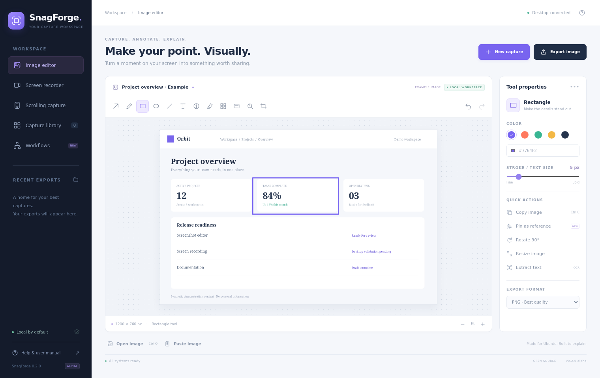
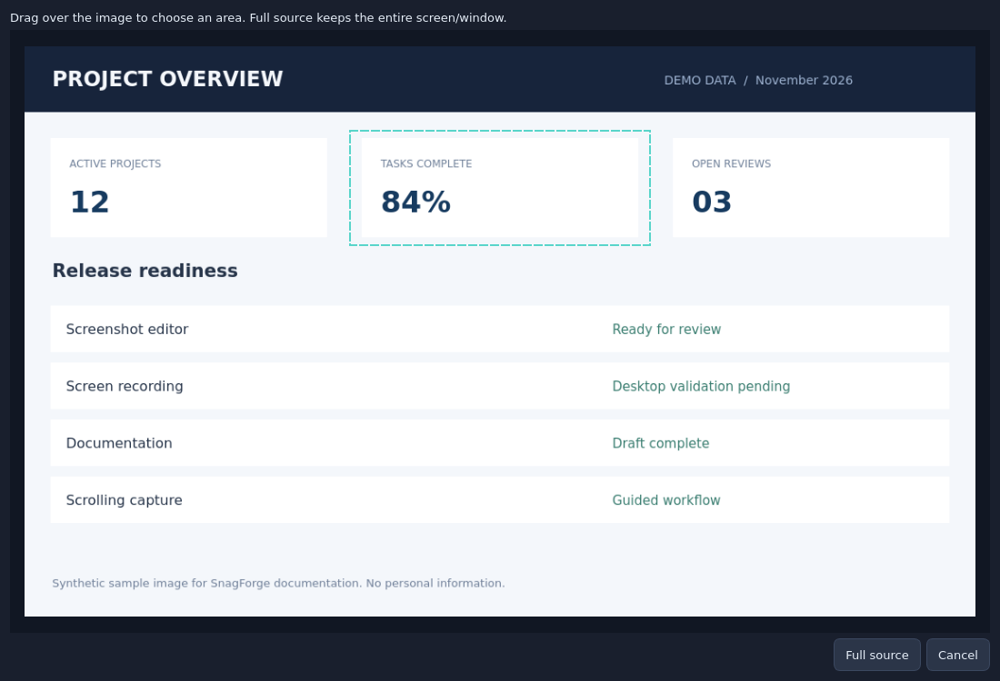
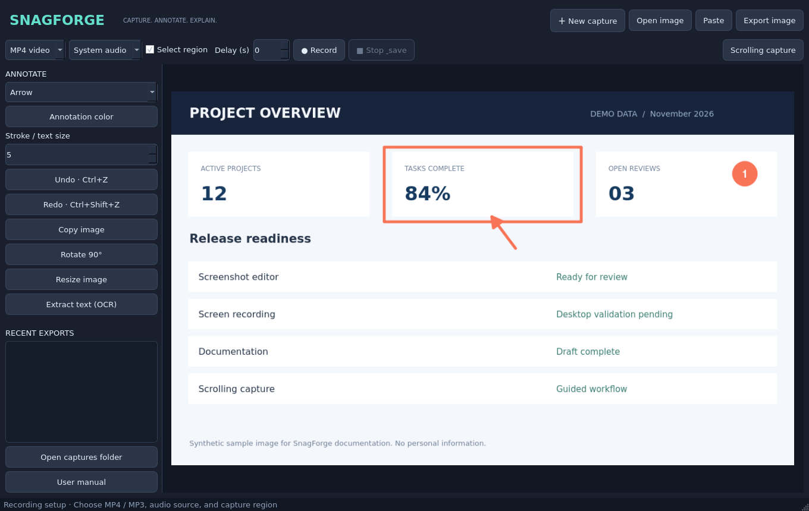
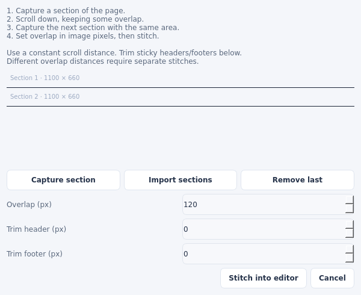

# SnagForge

**Capture. Annotate. Explain.**

An independent, GPL-3.0-licensed screenshot and recording workbench built for Ubuntu desktops. Inspired by common screen capture workflows; not affiliated with TechSmith and not compatible with Snagit project files.

**Version 0.3.3-alpha · Target: Ubuntu 26.x GNOME / Wayland · Python 3.10+ · Angular 22**

> This is an early source release, not full Snagit feature parity. Editor, stitching, selection mapping and portal protocol behavior have automated tests. Live capture, audio and encoding still require validation on a real Ubuntu 26 desktop. There are no fabricated recording screenshots or claimed live recording results.



## Install on Ubuntu

Keep the extracted project in a permanent directory before installing; the launcher refers to that directory.

```bash
chmod +x install.sh run.sh publish.sh
./install.sh --system-deps
./run.sh
```

The first command installs Ubuntu packages with `sudo`, creates a project-local virtual environment, downloads Python dependencies from PyPI and adds an application menu entry. Run it as your normal desktop user. If dependencies are already installed, use `./install.sh`.

Install dependencies only on the Ubuntu computer where you want to run the app. Do not run the GUI as root. No Docker, web server or account is needed to use it.

## What changed in 0.3.3

- An orange and charcoal interface with an author credit for **Sinan Ozgu Karasulu**, plus a folded-S app icon used in the sidebar, tray, window and desktop launcher.
- **Copy file path** and **Delete** in Capture library. Delete confirms before moving files to Trash; active captures cannot be deleted. The native recent-export list offers these actions in its right-click menu.
- High-quality H.264 recording at the captured source dimensions and 30 fps, using constant-quality Q18 encoding with a 50 Mbps ceiling. Files can be larger than earlier recordings; live encoder validation is still required.
- Video area selection uses the existing window and locks the rectangle when the mouse is released. Errors restore the application and request foreground focus with **OK** selected.
- One SnagForge session per user. Repeated launches request the existing window.
- A system tray menu with **Take screenshot**, **Record selected area**, **Record full screen / window**, **Stop & save**, **Open SnagForge**, and **Quit SnagForge**. Closing the window hides it when the desktop provides system tray support. GNOME needs an enabled tray/AppIndicator implementation; if unavailable, closing the window exits normally.

To start independently of your terminal:

```bash
./start.sh
```

You can then close the terminal. Diagnostics go to `~/.local/state/SnagForge/snagforge.log` (or the configured XDG state directory). Use **Quit SnagForge** from the tray to exit. The existing `./run.sh` remains the foreground/debug launcher. If a capture is running, stop and save it before quitting.

## What changed in 0.3.2

Selected-area capture now keeps the marquee visible after the mouse is released. Redraw until the rectangle is correct, then explicitly choose **Capture selected area** or **Record selected area**. The recorder replaces its checkbox with clear **Selected area** and **Full screen/window** buttons. While recording, an always-on-top controller shows elapsed time and a **Stop & save** button.

## What changed in 0.3.1

The recording marquee and all native recording dialogs are now parented to the visible Angular shell instead of the hidden capture engine. Recordings auto-save into `~/Pictures/SnagForge`, preview generation validates its PNG output, and a finalized MP4 is accepted after a user stop even when GStreamer reports the interrupt signal as its process status.

## What changed in 0.3.0

The professional annotation toolkit adds callout bubbles, approval stamps, magnified detail regions, and capture-information cards containing the Ubuntu kernel, date/time, image dimensions and SnagForge attribution. All four tools work in both the Angular and native editors and participate in undo/redo history.

## What changed in 0.2.2

Region video is now a first-class workflow: **Select area & record** opens the Ubuntu permission picker and then a full-screen, always-on-top crosshair marquee. Only the selected source rectangle is encoded, with even-dimension normalization for H.264. The native interface also exposes **Ctrl+Shift+R** for this action.

## What changed in 0.2.1

A new offline Angular desktop interface provides a focused image editor, recording setup, searchable recent-export library and local after-capture workflows. The native Python / PipeWire / GStreamer engine handles desktop operations through Qt WebChannel. Node.js is needed only to rebuild the interface; the prebuilt UI is included.

The patch fixes a GNOME portal cleanup race that could escape `QThread.run()` after recording. It also adds a full-screen desktop-style marquee with a crosshair and live pixel dimensions, a Gaussian blur tool, and a one-click border/shadow frame. Existing 0.2 additions include pinned references and three local screenshot workflows: annotate first, quick copy, and save & copy.

## Features in this source release

| Capability | Status / behavior |
|---|---|
| Screenshots | Desktop portal permission flow, then a full-screen marquee overlay; drag a region, press Enter for full source, or Esc to cancel |
| Screen/window recording | MP4, H.264 video, 30 fps, desktop portal + PipeWire + GStreamer; desktop validation pending |
| Region video | Dedicated **Select area & record** action with a full-screen crosshair marquee over the portal-approved desktop frame; cropped before encoding |
| Audio | Choose microphone/default input OR default system output; AAC in MP4, MP3 audio-only |
| Scrolling capture | Guided captures/imports, fixed manual overlap, optional header/footer trim; vertical only |
| Annotation | Arrow, line, pen, rectangle, ellipse, text, callouts, numbered steps, approval stamps, highlight and capture-info cards |
| Image editing | Crop, proportional resize, rotate, pixelate, Gaussian blur, opaque redact, spotlight, magnify, border/shadow frame |
| History | Undo/redo up to 20 raster snapshots in memory |
| Export | Flattened PNG, JPEG, WebP; image clipboard copy and paste |
| OCR | Local Tesseract text extraction, review/copy; no in-place text editing |
| Recent exports | Searchable last 80 image/audio/video exports in `~/Pictures/SnagForge`, newest first |
| Delay | 0–30 seconds before opening the capture flow |
| Reference windows | Pin a copy of the current image; topmost behavior depends on the compositor |
| After-capture workflows | Annotate first, quick copy, or save & copy; presets stay local |
| Help | Illustrated manual in Markdown and offline HTML, opened from the app |



## Record video or audio

1. Open **Screen recorder**. The top action now follows this page; **Take screenshot** on the editor is a separate action.
2. Choose **MP4 video** or **MP3 audio**, then an audio source. MP3 requires audio.
3. For video, choose **Selected area** or **Full screen/window**, then click **Select area & record** or **Record full source**. The top button starts the same recording workflow.
4. Approve a monitor or window in Ubuntu's screen-sharing permission picker. This is different from Ubuntu's screenshot dialog; you do not switch that screenshot dialog into video mode.
5. For selected-area recording, drag on SnagForge's preview and release to lock the box. Click **Record selected area**, or press Enter to confirm the selected rectangle.
6. Click **Stop & save** in the recording controller or tray menu. Wait for finalization. Exports are saved in `~/Pictures/SnagForge` and listed in Capture library.

There is currently no webcam, pause/resume or simultaneous microphone/system mixing. Restoring the app can appear in a full-monitor recording. Record a separate window to avoid that, or trim externally afterward. Audio-only uses the selected/default source without a screen picker.



## Scrolling capture

Use **Scrolling capture → Capture section**, scroll manually, and repeat. Select the same width/area and scroll by a constant distance. Set **Overlap (px)** to the duplicated vertical pixel count after header/footer trim. Choose **Stitch into editor**, inspect every seam, then export. Importing pre-captured sections also works.

This release does not automatically scroll, detect overlap or remove repeated sticky headers. Full instructions and worked pixel examples are in the [manual](docs/MANUAL.md).



## Documentation

- [Illustrated user manual](docs/MANUAL.md) · [Offline HTML manual](docs/MANUAL.html)
- [Feature comparison and roadmap](docs/FEATURES.md)
- [Validation and desktop acceptance checklist](docs/VALIDATION.md)
- [Contributing](CONTRIBUTING.md) · [Security](SECURITY.md) · [GPL-3.0 license](LICENSE)

## Development

The primary UI is in `frontend/src/`, built with Angular 22 and TypeScript. `web_shell.py` hosts the prebuilt UI and provides the native bridge. `ui.py` supports the alternative native Qt editor. Use `.venv/bin/python app.py --native` for that interface.

To rebuild the frontend with Node.js 24 LTS:

```bash
cd frontend
npm ci
npm run build
```


```bash
python3 -m venv .venv
.venv/bin/python -m pip install -r requirements.txt
QT_QPA_PLATFORM=offscreen .venv/bin/python -m unittest discover -s tests -v
QT_QPA_PLATFORM=offscreen .venv/bin/python docs/render_screenshots.py
.venv/bin/python app.py
```

Application modules: `app.py` (native editor and launch selection), `editor.py` (raster editor), `portal.py` (D-Bus desktop requests), `workers.py` (capture/recording lifecycle), `media.py` (pipelines/stitching). Tests use synthetic images and a fake D-Bus transport; they do not record the developer's desktop.

Capture uses the system [Screenshot](https://flatpak.github.io/xdg-desktop-portal/docs/doc-org.freedesktop.portal.Screenshot.html) and [ScreenCast](https://flatpak.github.io/xdg-desktop-portal/docs/doc-org.freedesktop.portal.ScreenCast.html) portals. Media encoding uses [GStreamer](https://gstreamer.freedesktop.org/documentation/tools/gst-launch.html). UI rendering uses [Qt for Python](https://doc.qt.io/qtforpython-6/). The app executes local capture/encoder processes, not shell-interpolated media commands. Capture workers use separate threads.

## Source repository

The public project is [skarasulu19/SnagForge](https://github.com/skarasulu19/SnagForge).

```bash
git clone https://github.com/skarasulu19/SnagForge.git
cd SnagForge
chmod +x install.sh run.sh publish.sh
./install.sh --system-deps
./run.sh
```

The repository contains the application, illustrated manual, screenshots, tests and feature roadmap. It is an alpha source release; live Ubuntu 26 capture validation is pending.

## Licensing

This repository uses GPL-3.0, as selected when the repository was created. The original alpha's MIT copyright and permission notice is retained in LICENSE-MIT. Dependencies retain their own licenses: PySide6/Qt include LGPL/GPL/commercial terms, dbus-next is MIT, Pillow has its own permissive license, and GStreamer components/codecs have their own terms. This is source distribution; review dependency and codec obligations before redistributing a bundled binary. Snagit names are used only for comparison, without copied branding or assets.

## Author

Sinan Ozgu Karasulu

## Checks

The current Python suite has 44 passing tests and one local-socket integration test skipped in restricted environments. The actual Angular desktop window was exercised with synthetic images: startup, native bridge synchronization, rectangle annotation, native clipboard copy, undo/redo, and three rendered UI screenshots. Live Ubuntu 26 screen/audio recording remains unverified. See [validation](docs/VALIDATION.md) and the [Snagit + ShareX hybrid roadmap](docs/HYBRID_ROADMAP.md).

