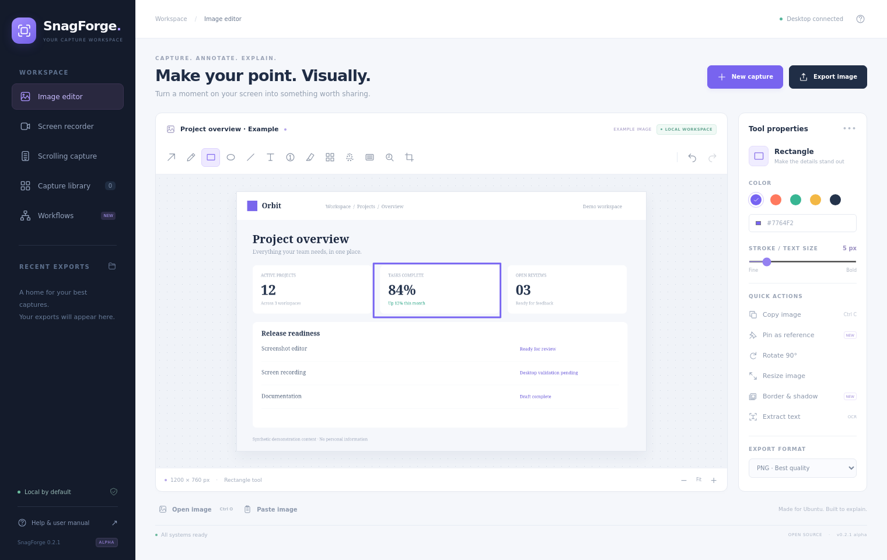
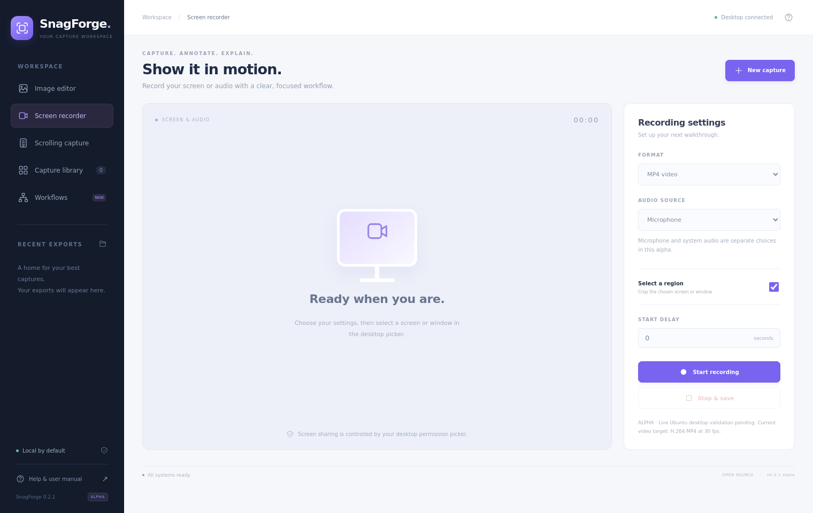
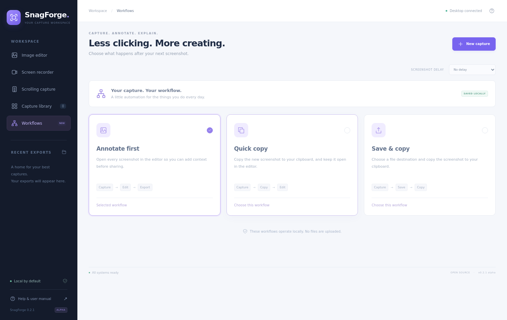

# SnagForge user manual

**0.2.1 alpha · Angular desktop interface · Ubuntu 26.x target**

SnagForge is an independent, open-source capture studio inspired by screenshot editing and automation workflows. The Angular interface runs locally in a Qt desktop window and communicates with a native Python capture engine. No web server or cloud account is required for desktop use.

The editor and native bridge have been exercised with synthetic data. Live GNOME/Wayland capture, sound routing and media encoding still require Ubuntu desktop acceptance testing. Do not treat the screenshots in this manual as evidence of successful video capture.



## 1. Install and launch

Clone or download the repository into a permanent folder. In that folder run:

```bash
chmod +x install.sh run.sh publish.sh
./install.sh --system-deps
./run.sh
```

Run as a normal desktop user. The installer installs Ubuntu dependencies using sudo, creates a local Python virtual environment, downloads dependencies from PyPI, and creates an Applications menu entry. The folder must remain in place because the launcher points to it.

The prebuilt Angular interface is included in `frontend/dist/`. End users do not need Node.js to launch it. Front-end contributors use Node.js 24 LTS, then run `npm ci` and `npm run build` inside `frontend/`.

## 2. Find your way around

- **Image editor:** annotate and export a screenshot or image.
- **Screen recorder:** choose video/audio settings and start or stop recording.
- **Scrolling capture:** open the native guided stitching dialog.
- **Capture library:** search the last 80 exports in the default capture folder and reopen them.
- **Workflows:** choose what happens after a screenshot and set screenshot delay.
- **Help & user manual:** open this offline guide.

The status at the top says **Desktop connected** when the Angular interface is connected to the native engine. A browser-only preview is explicitly labeled **Interface preview**. It supports opening and editing images, but native capture, clipboard, OCR, pinned windows and recording require the desktop application.

## 3. Take a screenshot

1. Click **New capture** or press **Ctrl+N**.
2. Approve the system screenshot picker and select the source it offers.
3. A full-screen marquee opens over the portal-approved frame. Drag the exact rectangle you want; its pixel dimensions appear beside it. Press **Enter** for the full source or **Esc** to cancel.
4. The resulting image opens in the Angular editor.

Wayland does not let applications read the desktop freely. SnagForge therefore builds the desktop-style overlay from the frame approved by GNOME's portal instead of bypassing the permission model. The overlay is full-screen and visually matches the selected source, but it is not an unrestricted transparent view through to the desktop. Cancel any picker or press **Esc** to exit without replacing the image.

Configure a 0, 3, 5, 10 or 30 second screenshot delay in **Workflows**. A delay is useful for opening a menu before capture.

## 4. Open, annotate and edit an image

Click **Open image**, press **Ctrl+O**, or drop a PNG/JPEG/WebP/BMP into the editor. File import is limited to 50 MB and images to 100 megapixels. Existing unsaved work prompts before replacement.

Choose a tool in the toolbar, then drag directly on the image:

| Tool | Use |
|---|---|
| Arrow / line | Point to an important detail |
| Pen | Draw freehand |
| Rectangle / ellipse | Outline an area |
| Text | Click the location, enter text and choose Add text |
| Step | Add sequential numbered markers |
| Highlight | Add a translucent yellow emphasis |
| Pixelate | Obscure visual detail; unsuitable for protecting secrets |
| Blur | Apply a Gaussian blur to distracting details; use Redact for secrets |
| Redact | Replace selected pixels with an opaque dark rectangle |
| Spotlight | Dim everything outside the chosen area |
| Crop | Keep the selected rectangle |

Use **Tool properties** for color and stroke/text size. Use **Undo** / **Redo** or **Ctrl+Z** / **Ctrl+Shift+Z**. History retains up to 20 image snapshots in memory. Annotations are raster edits, not movable vector objects, and history is not saved with exports.

**Rotate 90°** rotates clockwise. **Resize image** asks for a new pixel width and preserves the aspect ratio. **Border & shadow** places the image on a light frame with a subtle shadow. The minus/plus controls adjust the view; they do not resize exported pixels.

**Explore with an example** loads synthetic demonstration content. It is an optional example, not a captured desktop.

## 5. Export, copy and paste

Choose PNG, JPEG or WebP in the properties panel, then click **Export image** or **Ctrl+S**. Select the destination in the native save dialog. PNG preserves lossless image detail; JPEG is typically smaller but lossy.

**Copy image** / **Ctrl+C** places the current raster image on the system clipboard. **Paste image** / **Ctrl+V** imports a clipboard image. Browser-only preview uses downloadable exports and does not claim native clipboard support.

By default files are saved under `~/Pictures/SnagForge`. The library only scans that default folder, even if you save some exports elsewhere.

## 6. Pin a reference and extract text

**Pin as reference** opens a separate window containing a copy of the current image. It requests always-on-top behavior; GNOME/Wayland may interpret that hint differently. Closing the reference window leaves the image in the editor unchanged.

**Extract text** uses local Tesseract. Review the result in the native dialog and confirm to copy it. OCR currently extracts text; it does not edit text inside screenshots. Tesseract's installed language data controls recognition.

## 7. Record screen video or audio



1. Open **Screen recorder**.
2. Choose **MP4 video** or **MP3 audio**.
3. Choose **None**, **Microphone**, or **System audio**. MP3 requires an audio source.
4. For video, enable **Select a region** if you want cropping.
5. Optionally set a delay and click **Start recording**.
6. Choose the output file. For video, approve the desktop screen/window picker.
7. If region selection is enabled, drag a rectangle on the full-screen source overlay. The displayed dimensions map to source pixels.
8. Restore SnagForge and click **Stop & save**. Wait for the file to finalize, then verify playback.

Current video encoding uses software x264 / H.264, MP4 and 30 fps. Audio in MP4 uses AAC; audio-only export uses MP3. Hardware encoding, 60 fps, webcam overlays, pause/resume, audio meters, simultaneous microphone/system mixing, noise reduction and built-in video trimming are not implemented.

Restoring SnagForge can appear in a full-monitor recording. Capture a separate window to avoid that where possible. The alpha has no recording tray control. An interrupted recording or unavailable source can leave a partial file. Live portal capture, encoding and audio routing remain unverified on Ubuntu 26.

## 8. Guided scrolling capture

Open **Scrolling capture**. Capture or import at least two sections in top-to-bottom order. Use the same capture width and a constant vertical scroll distance. Set the duplicated **Overlap (px)** after any header/footer trim, then choose **Stitch into editor**.

For two 800-pixel sections sharing 120 pixels, the result is `800 + 800 - 120 = 1,480` pixels tall. Inspect every seam before export. Header/footer trimming removes the specified number of rows from every section before stitching.

This is manual vertical stitching. Automatic scrolling, automatic overlap detection, horizontal panorama and automatic sticky-header removal remain roadmap items.

## 9. Workflows and the capture library



Choose one preset:

- **Annotate first:** open the screenshot in the editor.
- **Quick copy:** copy the new screenshot to the clipboard and open it in the editor.
- **Save & copy:** copy the screenshot and ask where to save it.

The choice is saved locally. These presets never upload files. Capture permissions and save dialogs still require your interaction.

The **Capture library** provides filename search over recent exports from the default folder. Click an image to reopen it; audio/video opens in your system player. Persistent project storage, tags, collections and cloud sync are not implemented.

## 10. Shortcuts

| Shortcut | Action |
|---|---|
| Ctrl+N | New screenshot |
| Ctrl+O | Open image |
| Ctrl+S | Export image |
| Ctrl+C / Ctrl+V | Copy / paste image |
| Ctrl+Z / Ctrl+Shift+Z | Undo / redo |
| Escape | Cancel the active stroke or text dialog |

These shortcuts work while the application has focus. They are not global desktop capture or recording-stop shortcuts.

## 11. Troubleshooting and native fallback

- No capture: check that the desktop portal and PipeWire are running; approve the system picker.
- No recording: verify GStreamer dependencies and the validation checklist in `VALIDATION.md`.
- No sound: check the selected default input/output device. Microphone and system audio are separate modes.
- No OCR: install Tesseract and appropriate language data.
- Blank Angular window: verify `frontend/dist/` exists and Qt WebEngine dependencies are installed. Do not disable the browser sandbox to work around startup errors.

For the alternative native Qt interface run `.venv/bin/python app.py --native`. It uses the same capture engine with native Qt controls.

## 12. Remove the application

Close SnagForge and remove `~/.local/bin/snagforge` and `~/.local/share/applications/snagforge.desktop`. Delete the project folder when no longer needed. Captures in `~/Pictures/SnagForge` remain separate. Shared Ubuntu dependencies are not removed automatically.
