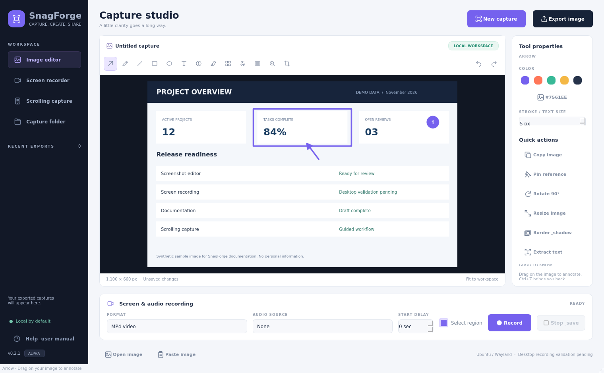
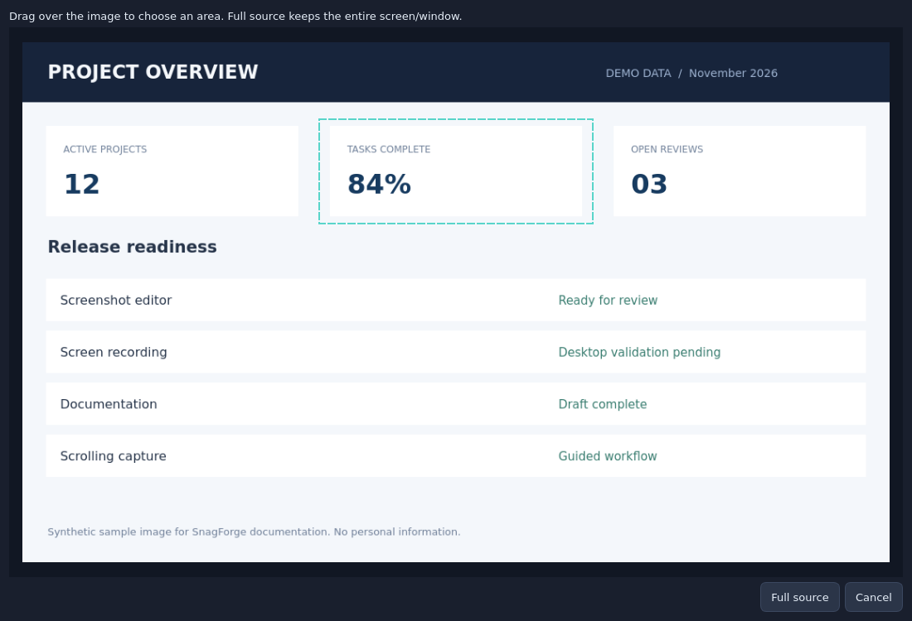
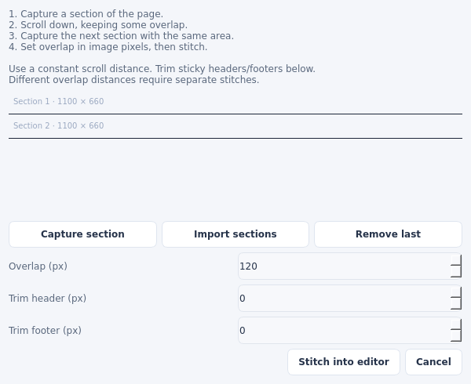
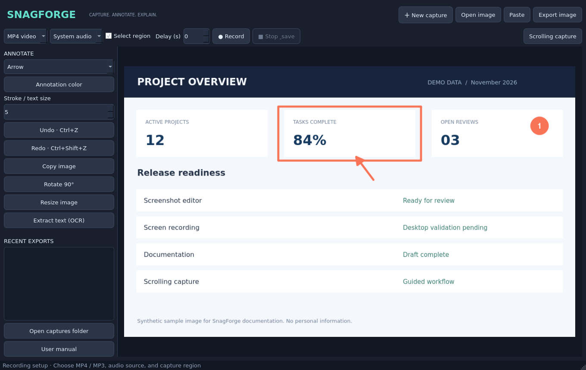

# SnagForge user manual

**Version 0.1.0-alpha — 6 November 2026**

SnagForge is a native Python/Qt capture workbench targeting Ubuntu 26.x. The editor and guided stitching are tested offscreen. The desktop capture/recording integrations are implemented but still need real GNOME/Wayland acceptance testing. Read the validation checklist before relying on it for important recordings.

## 1. Install and launch

Extract the project into a permanent folder. In that folder run:

```bash
chmod +x install.sh run.sh publish.sh
./install.sh --system-deps
./run.sh
```

Use your normal desktop user account. The installer asks for administrator privileges only when installing Ubuntu system dependencies. It creates `.venv`, an application launcher in `~/.local/bin`, and an Applications entry. Moving the source folder afterward breaks the launcher; rerun the installer after a move. Internet access is needed for installation, not routine capture/editing.

The dependencies include Python, Qt, D-Bus, PipeWire GStreamer source, PNG/MP3/H.264/AAC encoders and a GNOME portal backend. OCR uses local Tesseract. Audio uses Ubuntu's PulseAudio compatibility interface, normally provided by PipeWire.

## 2. Find your way around



The top row opens or captures an image and exports it. The second row sets recording format, audio, region selection and capture delay. The left panel holds annotation tools, editing actions, recent exports and this manual. The central canvas fits the image to the window; all drawing coordinates are converted back to original image pixels.

The preview is fit-to-window, without a zoom or pan control. Very small details are easier to annotate after cropping. **Stroke / text size** changes original-pixel drawing size, rather than display pixels.

## 3. Capture a picture

1. Click **New capture** or press **Ctrl+N**.
2. Save/discard your current image if prompted.
3. The app hides, waits for the selected delay, then requests a desktop screenshot.
4. Approve or use the system screenshot picker. The exact choices depend on your desktop's portal backend.
5. SnagForge opens a preview. Drag a rectangle for an area, or click **Full source** for the entire returned image.
6. Annotate and export.



Selection is performed on a captured preview, not a transparent live desktop overlay. The system picker may already offer area/window selection. If you want predictable coordinates for a scrolling sequence, always use the same system selection and the same SnagForge crop. Escape/Cancel exits the preview.

The delay is measured before opening the portal picker. It gives you time to arrange menus, but does not guarantee a menu remains open through every desktop's permission dialog.

## 4. Open an existing picture

Use **Open image**, **Ctrl+O**, or paste an image from the clipboard with **Paste / Ctrl+V**. Supported import formats include PNG, JPEG, WebP and BMP. Double-click an image in Recent exports to open it. A replacement prompt protects an image that has not been exported.

## 5. Annotate and edit

Choose a tool in the left dropdown. Choose a color and stroke size, then drag on the canvas.

| Tool | Use |
|---|---|
| Arrow / Line | Drag from the starting point to the target. |
| Pen | Drag a freehand stroke. |
| Rectangle / Ellipse | Drag diagonally across the area to outline. |
| Text | Click or drag at the intended top-left position, then enter text. |
| Step | Click to place a numbered badge. Numbers increase during the session and reset on a new image. |
| Highlight | Drag a translucent yellow rectangle. |
| Pixelate | Drag an area to mosaic its contents. |
| Redact | Drag an area to replace it with opaque black pixels. |
| Spotlight | Drag the area to keep bright; the surrounding image becomes dim. |
| Crop | Drag to retain only the selected rectangle. |

**Rotate 90°** rotates clockwise. **Resize image** asks for a width and preserves aspect ratio. Text is rasterized after you enter it; there are no movable annotation objects or editable layers in this release.

Undo restores up to 20 previous image snapshots; redo restores an undone operation. New edits clear redo. Step numbering is a session counter and does not rewind when a step is undone. Large images can use substantial memory because history stores image copies.

For confidential material, use **Redact** and inspect the exported image. Pixelation is a visual effect and may leave text inferable. Undo history remains in memory until a new image is opened or the app closes. This release does not save an editable project containing the original and redactions.

## 6. Capture a scrolling window



This is a guided vertical stitcher. You control scrolling and the repeated overlap.

1. Open **Scrolling capture**.
2. Click **Capture section**. The app hides so you can capture the target window.
3. Select the content area. Exclude window borders and sticky headers if possible.
4. Scroll the target down a known, constant distance, leaving visible overlap.
5. Capture the next section using exactly the same width and dimensions.
6. Repeat, or use **Import sections** to add existing images in top-to-bottom order.
7. Set optional **Trim header** and **Trim footer** in original image pixels. These values are removed from every section.
8. Set **Overlap** to the number of repeated rows between the trimmed sections.
9. Click **Stitch into editor**, inspect seams, annotate, and export.

For example, two sections each 800 pixels tall with 120 pixels of shared content produce a 1,480-pixel image: `800 + 800 − 120`. SnagForge retains the entire first section and drops the first 120 rows from each later section. If you trim 50 pixels from the top and 30 from the bottom, each section becomes 720 pixels tall; recompute overlap relative to that trimmed content.

Use a constant scroll distance for this release. Changing overlap between sections, horizontal capture, overlap detection and automatic scrolling are not implemented. Sticky or animated content can prevent a clean stitch. Remove a bad section with **Remove last**. Different widths are rejected. Combined output is limited to 100 megapixels.

## 7. Record MP4 video



1. Choose **MP4 video**.
2. Choose audio: **None**, **Microphone**, or **System audio**.
3. Enable **Select region** for a cropped recording, or disable it for the full chosen source.
4. Set an optional delay and click **Record**.
5. Choose the output filename. The app minimizes and opens the desktop screen/window picker.
6. Approve one screen or window. Multiple-source mixing is not implemented.
7. If a region is enabled, SnagForge takes one frame from that exact source and lets you drag a region on the preview. This avoids confusing monitor coordinates on a multiple-monitor desktop.
8. After selection, the recording starts and the app minimizes again.
9. Restore SnagForge and press **Stop & save**. Keep the app open while it sends end-of-stream to finalize MP4 metadata.
10. Open the saved file from Recent exports or the capture folder.

The pipeline targets 30 fps and encodes H.264 video plus optional AAC audio. H.264 cropped dimensions are rounded down to even pixel counts; at most one pixel is removed from the right and bottom. Region selection uses the preview before recording, rather than a live overlay. Desktop capture can include the mouse cursor; no click ripple or cursor highlighting is added.

There is no pause, webcam overlay, recording tray button or built-in video trimming yet. Restoring SnagForge can appear in a monitor recording; choose a separate window for a cleaner output. If a source disappears or the portal session ends, recording may fail or require you to stop it. An error may leave a partial file. Check playback after every important recording.

## 8. Record MP3 audio

MP3 is audio-only. Select **MP3 audio**, then choose **Microphone** or **System audio**, click **Record**, choose a file, and later press **Stop & save**. No screen picker is needed. Encoding targets 192 kbps MP3.

**Microphone** uses the default audio input; verify it in Ubuntu Sound settings. **System audio** records the monitor of the default output sink resolved at recording startup. Switching your output device during a session does not follow the new device. Audio monitoring/levels and simultaneous microphone plus system audio mixing are not implemented.

## 9. Export and find files

**Export image / Ctrl+S** writes flattened PNG, JPEG or WebP. PNG is a good choice for screenshots and text. JPEG is lossy and removes transparency. Copy the image with **Copy image / Ctrl+C** for pasting elsewhere.

By default exports go into `~/Pictures/SnagForge`. You can choose another folder, but the Recent exports list only scans that default folder. It shows the last 80 matching files by modification date and is refreshed on startup and after exports. Double-click audio/video to open the system player. SnagForge does not upload captures or provide cloud links.

## 10. Extract text with OCR

Open an image and press **Extract text (OCR)**. Tesseract runs locally with its default recognition language and returns text in a review dialog. Edit it if needed and click OK to copy it to the clipboard. Cancel leaves the clipboard unchanged. OCR accuracy depends on resolution, font and language. This is text extraction, not in-place screenshot text editing. Large images may leave the UI busy while OCR runs, for up to its 40-second timeout.

## 11. Keyboard shortcuts

| Shortcut | Action |
|---|---|
| Ctrl+N | New screenshot |
| Ctrl+O | Open image |
| Ctrl+S | Export image |
| Ctrl+C | Copy image |
| Ctrl+V | Paste image |
| Ctrl+Z | Undo |
| Ctrl+Shift+Z | Redo |

These are active while SnagForge has keyboard focus. To launch the app from anywhere, you can configure a custom shortcut for `~/.local/bin/snagforge` in Ubuntu Settings → Keyboard. This opens the application; it is not a dedicated capture-only hotkey or an implemented global portal shortcut.

## 12. Troubleshooting

| Symptom | Check |
|---|---|
| Portal service/interface missing | Confirm a desktop session is running and the GNOME Screenshot/ScreenCast portal backend is installed. Do not run as root or in a headless SSH session. |
| Picker cancelled / no image | Try again and approve/select a source; cancellation creates no new image. |
| Black/no video preview | Source/backend may not provide frames. Try recording full source without region preview; check PipeWire and the portal backend. |
| `gst-launch-1.0` missing | Rerun `./install.sh --system-deps`. |
| Encoder or `pipewiresrc` missing | Check `gst-inspect-1.0 x264enc`, `pipewiresrc`, `avenc_aac`, `lamemp3enc`; install the listed Ubuntu packages. |
| No system audio | Confirm `pactl get-default-sink` returns the speaker/headset where audio plays. |
| No microphone audio | Set your microphone as the default input in Ubuntu Sound settings. |
| MP4 will not play | Stop with **Stop & save**, allow finalization, then check whether an encoder error or interrupted session left a partial file. |
| Stitch has duplicates/gaps | Correct overlap after trim, use the same area and a constant scroll distance, and inspect each seam. |
| Text OCR incorrect | Use a sharper source and the right installed Tesseract language; this release uses its default language configuration. |
| Launcher stopped working | The project folder may have moved. Rerun `./install.sh` from its permanent location. |

Useful local checks:

```bash
systemctl --user status xdg-desktop-portal pipewire
journalctl --user -u xdg-desktop-portal --since '10 minutes ago'
gst-inspect-1.0 pipewiresrc
gst-inspect-1.0 x264enc
gst-inspect-1.0 avenc_aac
pactl get-default-source
pactl get-default-sink
```

Avoid posting screenshots or logs containing private content in public bug reports. Include the Ubuntu version, session type (`echo "$XDG_SESSION_TYPE"`), app version, reproduction steps, and a sanitized error message.

## 13. Remove SnagForge

Close the app and remove `~/.local/bin/snagforge` and `~/.local/share/applications/snagforge.desktop`. Delete the project folder only when you no longer need its source and virtual environment. Captures in `~/Pictures/SnagForge` are separate and remain until you delete them yourself. The installer does not provide a package-managed uninstall or remove shared Ubuntu dependencies.

## 14. Scope and project status

SnagForge is an independent open-source alpha. It does not implement Snagit's proprietary AI features, file format, cloud services, automatic process recording or complete editing suite. See [FEATURES.md](FEATURES.md) for an explicit roadmap and [VALIDATION.md](VALIDATION.md) for the acceptance checklist.

All images in this manual are screenshots of actual SnagForge Qt widgets rendered offscreen with synthetic example content. They demonstrate the implemented UI and do not establish that live Ubuntu screen/audio capture has passed testing.
